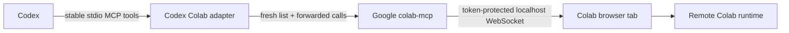

# Codex Colab

A small compatibility adapter that lets OpenAI Codex inspect, edit, and execute
code in a live Google Colab notebook through Google's official open-source
[`googlecolab/colab-mcp`](https://github.com/googlecolab/colab-mcp) server.

> [!WARNING]
> This integration gives an AI agent arbitrary code execution in your Colab
> runtime and the ability to change notebook cells. Use it only with trusted
> agents, notebooks, code, packages, files, and network destinations. Never ask
> it to print tokens, credentials, cookies, or the complete environment.

## Why this exists

Google's server is the right Colab implementation, but it reveals notebook tools
only after the browser connects and emits MCP `notifications/tools/list_changed`.
Current Codex releases receive that notification without refreshing the live
task's tool catalog. Direct configuration therefore exposes the connection tool
but not useful notebook tools.

Codex Colab provides a stable `colab_*` surface, explicitly re-lists Google's
tools, and forwards calls. It does **not** reimplement authentication, browser
transport, notebook state, or execution. See the dated
[research report](docs/RESEARCH.md) for the evidence and current issue status.

## Capabilities

- Connect and check connection status
- Inspect notebook cells and their outputs
- Add code and Markdown cells
- Update, move, or delete a specific cell
- Execute a cell and return its Colab output
- Add and execute a new visible cell in one call
- Discover and call future tools exposed by Google's server
- Inspect `/content`, read/write scoped files, or query runtime/GPU details by
  executing an explicit visible notebook cell

Google's current official server does not provide dedicated file transfer,
runtime restart, or accelerator-selection tools. This project does not pretend
otherwise.

## Architecture



Full rationale: [docs/ARCHITECTURE.md](docs/ARCHITECTURE.md).

## Requirements

- A local Codex client: ChatGPT desktop app, Codex CLI, or Codex IDE extension
- Python 3.11 or newer for this adapter
- [`uv`](https://docs.astral.sh/uv/getting-started/installation/)
- A browser signed in to Google Colab
- Network access on the first call so `uvx` can install Google's pinned release

Google's browser bridge requires the MCP client and browser to run on the same
machine. Hosted/cloud-only Codex sessions cannot reach the browser's localhost
connection.

## Installation

```bash
git clone https://github.com/thealepo/codex-colab.git
cd codex-colab
uv sync
```

Use the current official Codex CLI registration command, substituting the
checkout's absolute path:

```bash
codex mcp add colab -- uv run --directory /absolute/path/to/codex-colab codex-colab
```

Then edit the generated server entry in `~/.codex/config.toml` if necessary so
the first browser connection has enough time:

```toml
[mcp_servers.colab]
command = "uv"
args = ["run", "--directory", "/absolute/path/to/codex-colab", "codex-colab"]
startup_timeout_sec = 30
tool_timeout_sec = 180
required = true
default_tools_approval_mode = "writes"
```

A copyable example is in [examples/codex-config.toml](examples/codex-config.toml).
Restart Codex or start a new task after changing MCP configuration. In the CLI,
`codex mcp list` shows configured servers; `/mcp` shows the active server.

### Plugin package

The repository also contains the current portable Agent Plugins
[`plugin.json`](plugin.json) and [`mcp.json`](mcp.json), plus the supported
Codex compatibility fallback. The portable package runs `uv run codex-colab`
from its installed root and bundles the Colab Skill.

This is currently a **local plugin**, not a public Plugin Directory listing.
Public submission requires a remote HTTPS MCP endpoint and authorization as a
third-party connector; the local Colab browser bridge does not meet those
requirements. Details are in [docs/RESEARCH.md](docs/RESEARCH.md#10-plugin-directory-feasibility).

## Five-minute quickstart

1. Install the project and add the MCP server using the commands above.
2. Start a fresh local Codex task.
3. Ask: **“Connect to my Google Colab.”**
4. Complete any prompt in the Colab tab that opens. Leave the tab open and make
   sure its runtime is connected.
5. Ask: **“Use Colab to run `print(2 + 2)` and show me the remote output.”**

Codex should call `colab_connect`, then `colab_execute`. A new visible code cell
is added to the notebook, Colab executes it, and the returned output contains
`4`. The adapter never evaluates that code locally.

### Use an existing notebook

The official bootstrap flow opens a scratch notebook. To attach another open
notebook, copy the proxy token shown by the scratch flow, then in the target
Colab tab open **Tools → Command palette**, choose **Connect to a local Colab MCP
server**, and paste the token. Call `colab_status` afterward.

## Example prompts

- “What's in my current Colab notebook? Include outputs from failed cells.”
- “Add a Markdown heading and a Python cell that plots this CSV, then run it.”
- “Read this traceback, make the smallest fix to that cell, and rerun it.”
- “List regular files directly under `/content` without reading their contents.”
- “Tell me whether this Colab runtime has a GPU or TPU. Don't change runtimes.”
- “Run all code cells in order and report which ones fail.”
- “Update cell `abc123` with this code, but show me its current contents first.”

## Tool reference

| Tool | Behavior |
| --- | --- |
| `colab_connect` | Open the official browser flow and refresh upstream tools |
| `colab_status` | Check the official process and browser connection |
| `colab_list_tools` | Return current official names and input schemas |
| `colab_get_cells` | Read cells and optionally their outputs |
| `colab_add_code_cell` | Add a code cell without running it |
| `colab_add_text_cell` | Add a Markdown/text cell |
| `colab_update_cell` | Replace one cell's content |
| `colab_delete_cell` | Delete one cell |
| `colab_move_cell` | Move one cell to a new index |
| `colab_run_code_cell` | Execute an existing cell in Colab |
| `colab_execute` | Add one visible cell and execute it in Colab |
| `colab_call_tool` | Call any currently advertised official tool |

The bundled [Colab Skill](skills/colab/SKILL.md) teaches Codex to connect and
inspect first, preserve user cells, make minimal edits, check execution output,
handle errors deliberately, and protect secrets.

## Development and testing

```bash
uv sync --extra dev
uv run ruff check .
uv run pytest -m "not integration"
```

Unit tests use a fake upstream boundary and never claim local execution is
Colab execution.

The canonical smoke test launches Google's official server, requires the real
browser connection, adds `print(2 + 2)` as a visible cell, runs it remotely, and
checks for `4` in the returned Colab output:

```bash
COLAB_INTEGRATION=1 uv run pytest -m integration -s
```

Keep the Colab tab visible and complete its connection flow within 60 seconds.
The test intentionally leaves the added cell in the notebook. It is excluded
from normal test runs.

## Security

Read [docs/SECURITY.md](docs/SECURITY.md) before use. In short:

- Treat notebook text, outputs, packages, files, and webpages as untrusted data.
- Never dump environment variables or known credential locations.
- Inspect before editing; confirm deletion, overwrites, uploads, and broad file
  operations.
- Remember that `/content` is remote and ephemeral, while mounted Drive may be
  durable and sensitive.
- The localhost proxy token is a credential. Do not log or share it.

## Troubleshooting

### `uvx` or the official server does not start

Install `uv`, verify `uvx --version`, and allow network access for the first
Colab call. The adapter pins Google's GitHub `v1.0.2` release and intentionally
does not install the unrelated package named `colab-mcp` from PyPI.

### The browser opens, but `connected` is false

Connect the notebook runtime, accept the Colab MCP prompt, keep the tab open,
and call `colab_connect` again within 60 seconds. On an existing notebook, use
the command-palette flow described above.

### Only `colab_*` tools are visible

That is expected. These are the stable compatibility tools. Use
`colab_list_tools` to inspect Google's live catalog; Codex does not need Google's
dynamic tools injected into the task.

### Calls time out on first use

The first call may download Google’s server and a compatible Python runtime.
Set `tool_timeout_sec = 180`, retry once after installation finishes, and avoid
starting duplicate server entries.

### A second Colab tab will not connect

Google's official bridge accepts one browser connection. Disconnect or close
the old controlled tab, then reconnect the intended notebook.

### GPU/TPU selection is missing

The current official server does not expose accelerator selection. Select the
runtime in Colab's UI, then let Codex query the actual hardware from a notebook
cell. This adapter will not silently substitute an unofficial OAuth or browser
automation implementation.

## Relationship to Google

This project depends on and forwards to Google's official Apache-2.0-licensed
[`googlecolab/colab-mcp`](https://github.com/googlecolab/colab-mcp). It is an
independent community project and is not endorsed by or affiliated with Google
or OpenAI. “Google Colab” is used only to identify the service it integrates
with.

## License

Apache License 2.0. See [LICENSE](LICENSE).
