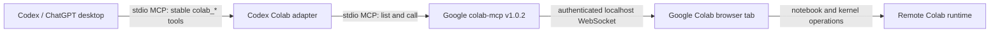

# Architecture

## Decision

Codex Colab is a compatibility adapter, not a Colab implementation. It exposes
a stable MCP tool set to Codex and delegates every browser/notebook operation to
Google's official `googlecolab/colab-mcp` process.

## Why the middle layer exists

Google's server advertises only `open_colab_browser_connection` at startup. The
browser adds cell tools later and sends `notifications/tools/list_changed`.
Current Codex tasks do not refresh their model-visible catalog in response.

The adapter avoids that dynamic boundary:

1. Its own `colab_*` list never changes during a Codex task.
2. `colab_connect` calls Google's bootstrap tool and immediately requests a
   fresh upstream list.
3. Every forwarded operation checks the fresh upstream schema, removes unknown
   convenience arguments, and calls the official tool.
4. `colab_list_tools` plus `colab_call_tool` provides forward compatibility for
   new official tools without adapter releases.

The child process starts lazily on the first Colab call. Codex can initialize
the adapter quickly even when `uvx` must download the pinned upstream release.

## Stable tool surface

| Adapter tool | Upstream behavior |
| --- | --- |
| `colab_connect` | Calls `open_colab_browser_connection`, then re-lists tools |
| `colab_status` | Infers connection from the fresh official tool list |
| `colab_list_tools` | Returns fresh names, descriptions, and input schemas |
| `colab_get_cells` | Forwards to `get_cells` |
| `colab_add_code_cell` | Forwards to `add_code_cell` |
| `colab_add_text_cell` | Forwards to `add_text_cell` |
| `colab_update_cell` | Forwards to `update_cell` |
| `colab_delete_cell` | Forwards to `delete_cell` |
| `colab_move_cell` | Forwards to `move_cell` |
| `colab_run_code_cell` | Forwards to `run_code_cell` |
| `colab_execute` | Adds one visible cell, captures its ID, then runs it |
| `colab_call_tool` | Validated escape hatch for any advertised official tool |

`colab_execute` is the only orchestration helper. It exists to make the canonical
remote-execution path unambiguous; it does not hide or delete the added cell.

## Boundaries and failure handling

- The adapter never opens a socket, interprets notebook content, or executes
  Python locally.
- The official child process owns the localhost token and WebSocket.
- The Colab browser owns notebook CRUD schemas and kernel execution.
- The adapter sends logs to stderr and never logs tool arguments or results.
- One operation lock keeps list/schema validation adjacent to its call and keeps
  the two-step execute workflow predictable.
- Upstream errors are returned as concise tool failures without echoing runtime
  contents or credentials into logs.

## Version policy

The default source is the official `v1.0.2` Git tag. Users can test another
official revision with `CODEX_COLAB_UPSTREAM_SPEC`. A release should update the
pin only after unit tests, manifest validation, and the real Colab smoke test.

Once Codex implements correct live `tools/list_changed` refresh, reassess this
adapter. The intended end state is to remove compatibility code rather than
grow an independent Colab implementation.

